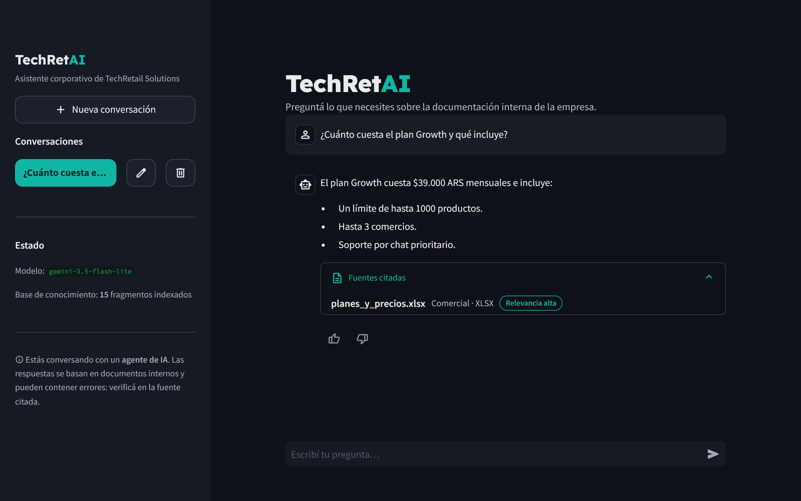
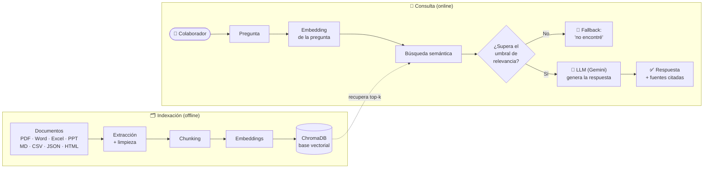

# 🤖 TechRetAI — Asistente RAG Corporativo

[](https://github.com/LeandroMelchiori/techretai_asistente_rag_corporativo/actions/workflows/ci.yml)
[](https://github.com/LeandroMelchiori/techretai_asistente_rag_corporativo/actions/workflows/deploy.yml)

Asistente que responde preguntas sobre la documentación interna de una empresa,
**cita las fuentes** y **se niega a responder** cuando la información no está en
los documentos. Está en producción, con evaluación propia, defensa contra
*prompt injection* y límites de uso.

**Demo en vivo: [techretai.sachadev.me](https://techretai.sachadev.me)** ·
Infraestructura como código: [infrastructure-as-code](https://github.com/LeandroMelchiori/infrastructure-as-code)



> Escenario ficticio: **TechRetail Solutions S.R.L.**, una plataforma SaaS de
> e-commerce para PyMEs en Argentina, con 15 documentos internos en 8 formatos
> (PDF, Word, Excel, PowerPoint, Markdown, CSV, JSON y HTML) y 7 áreas.

---

## 📊 Resultados

Medidos con [`eval/preguntas_eval.json`](eval/preguntas_eval.json) (18 preguntas
del dominio y 3 fuera de alcance), `gemini-embedding-2` y `gemini-3.5-flash-lite`:

| Métrica | Resultado |
|---|---|
| **Hit@5**: el documento correcto está entre los 5 recuperados | **100 %** (18/18) |
| **MRR**: qué tan arriba aparece el documento correcto | **0,972** (17/18 en primer lugar) |
| Preguntas fuera de alcance rechazadas | **3/3** (2 por el umbral, 1 por el modelo) |
| Latencia en el servidor (recuperación + generación) | **p50 1,4 s · p95 2,5 s** |
| Tests automatizados en CI | **25** |

El set es chico a propósito para iterar rápido; ampliarlo (casos multi-documento,
ataques y fidelidad de la respuesta) es el próximo paso de la [hoja de ruta](#-hoja-de-ruta).

---

## 🔧 Decisiones basadas en mediciones

**Calibrar la relevancia en lugar de confiar en un umbral fijo.** Con
`gemini-embedding-2` la similitud coseno tiene un piso alto: preguntas sin
relación (una receta de pizza, el Mundial 2022) puntúan entre 0,49 y 0,55, y el
documento correcto entre 0,56 y 0,81. El umbral original de 0,25 no filtraba nada
y la interfaz citaba los cinco documentos recuperados aunque no tuvieran relación.
Con el set de evaluación lo calibré a **0,53** y agregué un **margen relativo**:
sólo se usan y se citan los fragmentos a menos de 0,08 del mejor resultado. La
similitud se muestra como relevancia alta, media o baja, no como un porcentaje que
se lee como "coincidencia".

**Elegir el modelo por latencia medida.** `gemini-3.8-flash` tardaba entre 48 y
92 s por respuesta. Comparé modelos con el mismo flujo y las mismas preguntas:
`gemini-3.5-flash-lite` respondió correctamente en ~3 s, y la respuesta además se
muestra en *streaming* a medida que se genera.

---

## 🛡️ Ingeniería de producción

- **Infraestructura como código:** VM Ampere A1 (Always Free) en OCI con Docker y
  Traefik, definida con Terraform en un repositorio separado y compartida con otras
  aplicaciones. IP pública reservada.
- **Contenedor endurecido:** usuario sin privilegios, *filesystem* de solo lectura,
  `cap_drop: ALL`, `no-new-privileges`, límites de CPU y memoria, *healthcheck* y
  ningún puerto publicado en el host ([`deploy/oci/compose.yaml`](deploy/oci/compose.yaml)).
- **HTTPS** con certificados de Let's Encrypt, por aplicación.
- **Límites de uso:** 15 preguntas cada 10 minutos por IP, 300 por día y 500
  caracteres por pregunta. La IP la fija Traefik; verifiqué que un cliente no puede
  falsificarla con `X-Real-Ip` ni `X-Forwarded-For`.
- **Prompt injection indirecto:** los documentos se tratan como datos no
  confiables, aislados en bloques delimitados y sanitizados, con tests de ataque.
- **Despliegue continuo:** cada push a `main` que pasa los tests construye la imagen
  ARM64 en GitHub Actions y la publica en GHCR; la VM la despliega sola, fijada por
  digest, y vuelve a la versión anterior si no queda *healthy*. El pipeline espera
  a ver la versión nueva en producción. Sin SSH ni credenciales de OCI en GitHub.
- **Secretos fuera del repositorio:** la API key vive en la VM con permisos de root.

---

## ✨ Características

- **Multi-formato:** procesa PDF, Word (`.docx`), Excel (`.xlsx`), PowerPoint
  (`.pptx`), Markdown, CSV, JSON y HTML.
- **RAG completo:** extracción → limpieza → *chunking* → *embeddings* → base
  vectorial → recuperación semántica → generación con citación de fuentes.
- **Control de respuestas no fundamentadas:** si nada es suficientemente
  relevante, informa que no encontró la respuesta en vez de inventarla.
- **Respuestas en *streaming*** y fuentes citadas con su nivel de relevancia.
- **Proveedor intercambiable:** Google Gemini (por defecto) u OpenAI, cambiando
  una sola variable de entorno.
- **Interfaz de chat:** múltiples conversaciones, preguntas sugeridas, feedback y
  diseño accesible (objetivos táctiles de 44 px, foco visible, adaptada a celular).
- **Registro de ejecución:** consultas, relevancia, fuentes, latencia y feedback en
  JSON Lines para auditoría y análisis.

---

## 🏗️ Arquitectura



Cada componente del pipeline vive en un módulo con una única responsabilidad:

| Fase del pipeline | Dónde está en el código |
|---|---|
| Colecta y organización | `documentos/` + `scripts/generar_documentos.py` |
| Proceso y extracción | `src/ingestion/loaders.py`, `src/ingestion/chunking.py` |
| Indexación | `src/vectorstore.py`, `scripts/ingest.py` |
| Recuperación RAG | `src/vectorstore.py::query`, `src/agent.py` |
| Generación y fallback | `src/agent.py` |
| Proveedores de IA | `src/providers.py` |
| Interfaz | `app/streamlit_app.py` |
| Despliegue en OCI | `docs/deploy_oci.md`, `deploy/oci/compose.yaml`, `Dockerfile` |
| CI/CD | `.github/workflows/ci.yml`, `.github/workflows/deploy.yml`, `deploy/oci/autodeploy/` |
| Tests y evaluación | `tests/`, `eval/evaluar.py` |
| Registro de ejecución | `src/logging_utils.py`, `logs/consultas.jsonl` |

---

## 🚀 Puesta en marcha local

### 1. Requisitos

- Python 3.11+
- Una API key de [Google AI Studio](https://aistudio.google.com/app/apikey)
  **o** de [OpenAI](https://platform.openai.com/api-keys).

### 2. Instalación

```bash
git clone https://github.com/LeandroMelchiori/techretai_asistente_rag_corporativo.git
cd techretai_asistente_rag_corporativo

python -m venv .venv
source .venv/bin/activate       # Linux/macOS
# .venv\Scripts\activate      # Windows

pip install -r requirements.txt
cp .env.example .env
```

Completá en `.env` la API key del proveedor elegido.

### 3. Generar los documentos e indexarlos

```bash
python -m scripts.generar_documentos
python -m scripts.ingest --reset
```

### 4. Usar el agente

```bash
# Interfaz de chat
streamlit run app/streamlit_app.py

# Consulta desde terminal
python -m scripts.preguntar "¿Cuántos días de vacaciones me corresponden?"
```

---

## 💬 Preguntas de ejemplo

- *¿Cuántos días de vacaciones me corresponden con 6 años de antigüedad?* (RH)
- *¿Qué comisión cobra MercadoPago por tarjeta de crédito?* (Financiero)
- *¿Cuánto cuesta el plan Growth?* (Comercial)
- *¿Cómo funciona la facturación automática contra ARCA?* (Operacional)
- *¿Qué datos personales recolecta la empresa?* (Legal)
- *¿Qué endpoints tiene la API de TechRetail?* (Datos y Sistemas)

---

## 🔬 Tests y evaluación

**Tests automatizados** (unitarios, sin dependencias externas) que corren en CI
en cada push: limpieza y *chunking*, extractores de formato, lógica del agente
(fallback, deduplicación y filtrado de fuentes, respuesta en *streaming*), límites
de uso y ataques de *prompt injection*:

```bash
pip install -r requirements-dev.txt
pytest
```

**Evaluación del RAG:** un set de casos (`eval/preguntas_eval.json`) con la
fuente esperada de cada pregunta, más preguntas *fuera de alcance* que el agente
debe rechazar. Mide la calidad, no solo que "funcione":

```bash
python -m eval.evaluar
```

Los resultados actuales están en la sección [Resultados](#-resultados).

| Métrica | Qué mide |
|---|---|
| **Hit@k** | ¿El documento correcto aparece entre los `k` recuperados? |
| **MRR** | ¿Qué tan arriba aparece el documento correcto? |
| **Rechazo correcto** | ¿Rechaza las preguntas que no están en la base? |

---

## 🧠 Decisiones técnicas

- **RAG en lugar de *fine-tuning*:** los documentos internos cambian seguido. RAG
  permite actualizar la base sin reentrenar y, sobre todo, da **trazabilidad**
  (cada respuesta cita su fuente). Un modelo afinado sería más caro y opaco.
- **Umbral de relevancia + fallback:** se prioriza **no alucinar** sobre responder
  siempre. En dominios sensibles (Legal, RH, Finanzas) es preferible un "no
  encontré esta información" antes que una respuesta inventada.
- **ChromaDB como base vectorial:** embebida, sin infraestructura extra. La capa
  está aislada en `src/vectorstore.py`, así que migrar a *pgvector* u *Oracle
  23ai* si escalara es un cambio acotado.
- **Gemini con capa de proveedor intercambiable:** tier gratuito con embeddings;
  cambiar a OpenAI es una sola variable de entorno (`src/providers.py`).
- **Chunking por párrafos con superposición:** preserva el contexto sin cortar
  ideas; el conteo de tokens usa *tiktoken* con *fallback* local para no depender
  de la red al indexar.
- **Contenedor en una VM compartida en vez de Kubernetes:** el volumen no
  justifica orquestación; una VM Always Free con Docker + Traefik aloja varias
  aplicaciones y la infraestructura vive como código en otro repositorio.
- **Defensa contra *prompt injection* indirecto:** los documentos se tratan como
  **datos no confiables**, no como instrucciones. Se aíslan en bloques delimitados,
  se sanitiza el texto para que un documento no pueda falsificar esos delimitadores
  y el prompt del sistema tiene prioridad absoluta sobre cualquier orden incrustada.

---

## ⚙️ Configuración

Todas las opciones se controlan por variables de entorno definidas en
`.env.example`.

| Variable | Por defecto | Descripción |
|---|---:|---|
| `LLM_PROVIDER` | `gemini` | Proveedor: `gemini` u `openai` |
| `TOP_K` | `5` | Fragmentos recuperados por consulta |
| `MIN_RELEVANCE` | `0.53` | Similitud mínima para responder (calibrada con `eval/`) |
| `RELEVANCE_MARGIN` | `0.08` | Sólo se usan y citan fragmentos a esta distancia del mejor |
| `RATE_LIMIT_PER_CLIENT` / `RATE_LIMIT_WINDOW_MIN` | `15` / `10` | Preguntas por IP cada 10 minutos |
| `RATE_LIMIT_DAILY` | `300` | Preguntas por día entre todos los usuarios |
| `MAX_QUESTION_CHARS` | `500` | Largo máximo de una pregunta |
| `CHUNK_SIZE` | `800` | Tamaño de cada fragmento |

---

## 📁 Estructura del proyecto

```text
techretai_asistente_rag_corporativo/
├── documentos/                # Base ficticia: 8 formatos y 7 categorías
├── src/
│   ├── config.py              # Configuración central
│   ├── providers.py           # Gemini/OpenAI: LLM y embeddings
│   ├── ingestion/             # Extracción, limpieza y chunking
│   ├── vectorstore.py         # Base vectorial ChromaDB
│   ├── agent.py               # Orquestación RAG, fuentes y fallback
│   └── logging_utils.py       # Registro de ejecución
├── scripts/
│   ├── generar_documentos.py  # Documentación corporativa ficticia
│   ├── ingest.py              # Indexación
│   └── preguntar.py           # Cliente CLI
├── app/streamlit_app.py       # Interfaz de chat
├── tests/                     # Tests automatizados (pytest)
├── eval/                      # Set y script de evaluación del RAG
├── deploy/oci/compose.yaml    # Servicio para la plataforma Docker + Traefik
├── deploy/oci/autodeploy/     # Despliegue automático en la VM (systemd)
├── .github/workflows/         # CI (tests) + CD (imagen en GHCR y verificación)
├── docs/deploy_oci.md         # Guía de despliegue
├── Dockerfile
├── requirements.txt
└── .env.example
```

---

## ☁️ Despliegue en OCI

El agente está desplegado en **Oracle Cloud Infrastructure** como contenedor de
la plataforma Docker + Traefik: una VM Ampere A1 (Always Free) definida con
Terraform que aloja varias aplicaciones detrás de un único proxy con HTTPS. Cada
push a `main` que pasa los tests se despliega automáticamente.

La guía completa está disponible en [`docs/deploy_oci.md`](docs/deploy_oci.md).

También puede ejecutarse con Docker:

```bash
docker build -t techretai-agente .
# Indexa los documentos en un volumen y luego levanta la interfaz
docker run --rm --env-file .env -v techretai-data:/data techretai-agente python -m scripts.ingest
docker run -p 8501:8501 --env-file .env -v techretai-data:/data techretai-agente
```

---

## 🧪 Datos y alcance

Todos los documentos incluidos en `documentos/` son **datos ficticios**, creados
exclusivamente para demostrar el funcionamiento del asistente. No representan
información real de una empresa ni contienen datos personales reales.

TechRetAI es actualmente una demostración funcional. No debe utilizarse para
procesar documentación corporativa sensible sin implementar previamente los
controles de acceso, privacidad, seguridad y evaluación detallados en la hoja de
ruta.

---

## 🧭 Hoja de ruta

La evolución del proyecto se resume en diez mejoras prioritarias:

1. [x] **Evaluación del RAG:** conjunto de preguntas de referencia con métricas de recuperación (Hit@k, MRR) y rechazo correcto. _Latencia medida (p50/p95). Pendiente: fidelidad de la respuesta y costo._
2. [x] **Pruebas y calidad de código:** pruebas unitarias con mocks de proveedores y CI en cada push. _Pendiente: cobertura, linting, formateo y tipos._
3. [x] **Seguridad frente a prompt injection:** documentos tratados como datos no confiables, aislados en bloques delimitados y sanitizados, con prompt del sistema reforzado y tests de ataque indirecto. _Pendiente: validación de salida y ataques directos más sofisticados._
4. [ ] **Autenticación y permisos:** agregar usuarios, roles, sesiones y autorización por área durante la recuperación. _Hecho: límites de uso por IP y por día._
5. [ ] **Privacidad y logs:** anonimizar datos sensibles, permitir desactivar el registro de contenido y definir rotación y retención de logs.
6. [ ] **Resiliencia y manejo de errores:** ocultar errores técnicos, agregar timeouts, reintentos, health checks y fallback entre proveedores.
7. [ ] **Citaciones verificables:** guardar página, hoja, diapositiva o sección y permitir revisar el fragmento exacto utilizado.
8. [ ] **Mejora de recuperación:** evaluar chunking, búsqueda híbrida, reranking, eliminación de duplicados y reindexación incremental.
9. [ ] **Observabilidad:** crear métricas de calidad, uso, latencia, errores, feedback y costo por proveedor y versión del sistema.
10. [ ] **Evolución del producto:** persistir conversaciones, mejorar accesibilidad, administrar documentos desde una interfaz segura y separar el núcleo RAG de la interfaz para facilitar su escalabilidad.

---

## 📝 Licencia y autoría

Proyecto académico y demostrativo desarrollado por **Leandro Melchiori**.

El nombre TechRetail Solutions S.R.L. y toda la documentación corporativa del
repositorio se utilizan como escenario ficticio para demostrar la arquitectura y
el funcionamiento del asistente.
